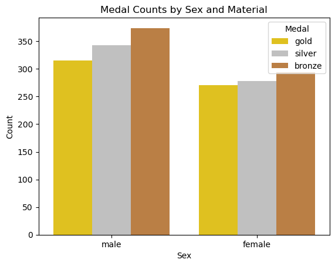

# Tidy Data Project: 2008 Olympic Medalists

## Project Overview
I created this Jupiter Notebook to further develop my skills in tidying data such that it can be analyzed and understood logically. 
This notebook's pivot tables and visualizations push beyond my first Tidy Data Project (Federal Research and Development Budgets) because the categorical data forces a level of creativity.
This is a cumulation not only of data tidying principles and methods, but also of how to analyze and visualize neat data represented in dataframes. 
The goal of this project was to organize an external dataset, which contained information regarding 2008 Olympic medalists for both men and women.

According to the Tidy Data Principles, neat data is such that:
- Every variable forms a column
- Every observation forms a row
- Each value is a cell

Prior to my analysis, the data was jumbled such that one column contained multiple variables. Here is a demonstration of how to melt data:
```
df_olymp_melted = pd.melt(df_olymp,
                          id_vars = 'medalist_name', # holds constant the column for medalist name
                          value_vars = df_olymp.columns[1:], # selects all the columns to be reoriented
                          var_name = 'sex_sport', # renames the column now containing the previous column names
                          value_name='Medal') #names the column containing all of the values from the original untidy dataframe
```
After tidying the data, I then created pivot tables to represent statistical information in a streamlined way.
The first considers the total number of medals for each sport, as well as the distribution between sexes and medal rankings. 
The second depicts the most common medal rank for both males and females within each sport. 

Demonstration of pivot table construction:
```
df_pivot1 = df_olymp_melted_tidy.pivot_table( # create a pivot table with the Sport as the index
    index='Sport',
    columns = 'Sex',
    values = 'Medal',
    aggfunc=lambda x: x.mode() # agg function is the most earned medal (i.e. mode) for each sport
)
```
With these pivot tables, and some additional calculations, I generated three visualizations which provide valuable insights into the data. Most notably, how the medal counts are distributed between gold, silver, and bronze medals for both male and female athletes.


## Instructions
To run this notebook, you must install and import several dictionaries which are later referred to. These include pandas, seaborn, and matplotlib.

To install:
```
!pip install pandas
!pip install seaborn
!pip install matplotlib.pyplot
```

To import:
```
import pandas as pd
import seaborn as sns
import matplotlib.pyplot as plt
```

Once the above have been run in your terminal and script respectively, the notebook will be accessible and legible such that the visualizations and analysis are understood. 
